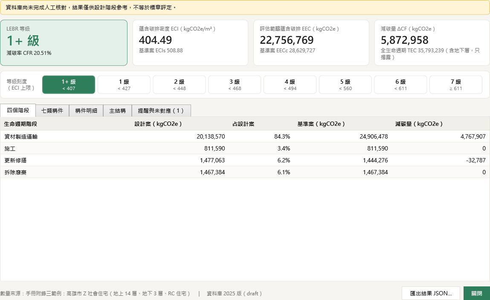

# 第1組｜LEBR 低碳建築碳排外掛

在 Revit 建好模型後按一個按鈕，依《2025 低碳（低蘊含碳）建築評估手冊》（LEBR）算出建築的蘊含碳排、減碳率與 1+～7 級，並可匯出結果 JSON 給網頁做視覺化。

## 先看哪份

| 你是 | 先看 |
|---|---|
| 想了解整個專案、接手的人 | [交接說明.md](交接說明.md) |
| 要用外掛、維護資料庫、改程式或做網頁的組員 | [組員操作指南.md](組員操作指南.md) |
| 只負責資料庫 | [lebr-db/交接說明_資料庫.md](lebr-db/交接說明_資料庫.md) |
| 只負責外掛 | [lebr-db/交接說明_外掛.md](lebr-db/交接說明_外掛.md) |
| 想看資料格式、構件代號規則 | [lebr-db/README.md](lebr-db/README.md) |

## 現況

| 部分 | 狀態 |
|---|---|
| LEBR 資料庫（附錄一 120 筆、附錄二 187 筆、參數表） | 完成，**待人工核對**（目前為草稿） |
| 計算引擎（式 1～27） | 完成，重現手冊附錄三：CFR 20.51%、1+ 級 |
| Revit 外掛（建立參數、模型數量擷取、計算前檢查、結果視窗） | Revit 2027 實測可用；Revit 2024 可編譯、尚未實測 |
| 網頁視覺化 | 未開始，結果格式範例見 `lebr-db/samples/sample_result.json` |

## 不在 repo 裡的東西

依本 repo 規則，下列檔案不放進 Git，請向組內索取「交接包」壓縮檔：

- 測試模型 `LEBR_test.rvt`（課程模型複本，已填好代號）
- 編譯好的外掛 DLL（可用 `lebr-db/revit-addin/install.ps1` 自行編譯安裝）
- 手冊 PDF（內政部建築研究所網站下載）
