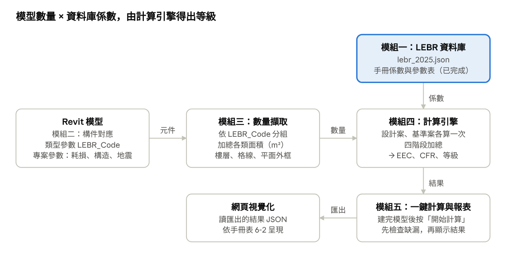
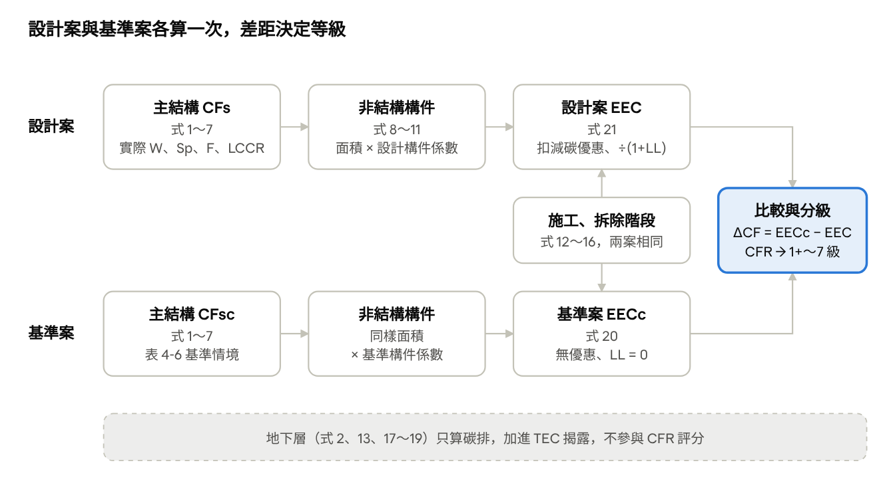

# Revit LEBR 碳排外掛計畫書

2026-10-23　｜　共兩頁，另一頁為 [公式運算邏輯](公式運算邏輯.md)

## 一、這個外掛要做什麼

建築師在 Revit 建完模型後按下「開始計算」，外掛依《2025 低碳（低蘊含碳）建築評估手冊》（LEBR）算出蘊含碳排與預估等級，最後匯出成網頁看結果。

**要做的：**

- 依手冊算 7 類構件：主結構，加上外牆外裝、外窗、透光帷幕、不透光帷幕、內隔間、室內地坪、戶外地坪。
- 算 4 個生命週期階段：製造運輸、施工、更新修繕、拆除廢棄。地上層評分，地下層只算碳排、不評分。
- 每次都同時算「設計案」與「基準案」，得到減碳率 CFR 和 1+～7 級。
- 建模過程中不計算。模型完成後按一個按鈕，外掛先檢查缺漏再計算，結果顯示在 Revit 視窗，另可匯出給網頁做圖表。

**第一版不做的：**

- 不取代送審報告書。結果是設計階段的參考，正式申請仍要評定專業機構審查。
- 不算營運碳排（用電、用水），那屬於建築能效評估 BERS。
- 不算室內裝修、景觀等手冊 3-2 節排除的項目。
- 低碳循環建材、低碳工法的減碳量要機構認證，由使用者手動輸入數字。

## 二、LEBR 怎麼算碳排（白話版）

LEBR 是「比較」制：同一棟建築算兩次，一次用實際設計（設計案），一次把構件換成手冊規定的一般做法（基準案），比較設計案少了多少碳排。

**第 1 步：算每類構件的碳排**。大部分構件是「面積 × 係數」，不是體積。係數已經包含新建，以及 60 年內翻修的碳排。

| 構件 | Revit 要給的數量 | 乘上什麼 | 手冊依據 |
| --- | --- | --- | --- |
| 主結構（地上） | 地上樓地板面積、樓層數、跨距、平面形狀，加上結構計算書的地震參數 | 公式算出每 m² 碳排 | 式 1～7 |
| 主結構（地下） | 地下樓地板面積 | 公式 | 式 2 |
| 一般外牆外裝 | 外牆面積（不含帷幕牆） | 附表 2-1 係數 | 式 11-1 |
| 外窗 | 窗面積（以外框尺寸計） | 附表 2-2 係數 | 式 11-2 |
| 透光帷幕外窗 | 透光部分面積 | 附表 2-3 係數 | 式 11-2 |
| 不透光帷幕及一般外牆 | 不透光部分面積 | 附表 2-4 係數 | 式 11-3 |
| 內隔間 | 非承重隔間牆面積 | 附表 2-5 係數 | 式 11-4 |
| 室內地坪 | 地坪面積（不含停車場、設備室、儲藏空間） | 附表 2-6 係數 | 式 11-5 |
| 戶外地坪 | 有基層的鋪面面積 | 附表 2-7 係數 | 式 11-6 |
| 施工、拆除廢棄 | 樓地板面積、樓層數 | 公式 | 式 12～19 |

主結構另有一個做法：從 BIM 讀混凝土體積、鋼筋重量，乘上附錄一的係數。手冊接受這個方法，但要另外建立基準案模型，並附上數量報告。

**第 2 步：加總後比較**。設計案的地上層蘊含碳排記為 EEC，基準案記為 EECc：

```
ΔCF = EECc − EEC        CFR = ΔCF ÷ EECc
```

**第 3 步：依減碳率 CFR 判定等級（表 5-1）**。1+ 級 > 20%、1 級 16～20%、2 級 12～16%、3 級 8～12%、4 級 3～8%、5 級 −10～3%、6 級 −20～−10%、7 級 ≤ −20%。跟基準案差不多，就是 5 級。

## 三、外掛整體架構

外掛分成五個模組，目前只有模組一（資料庫）完成。資料庫只管「係數」，Revit 只管「數量」，兩者在計算引擎相乘。



模組二（構件對應）不是獨立程式，而是建模者在 Revit 類型上填的參數。手冊改版時只要換資料庫，其他模組不用改。

## 四、模組一：LEBR 資料庫（已完成，待核對）

資料庫是一個 JSON 檔 `lebr_2025.json`，放在外掛資料夾，外掛啟動時讀一次。它只存手冊上的係數，不存任何專案的數量。

| 內容 | 筆數 | 用在哪裡 |
| --- | --- | --- |
| 附錄一 P-LCC 初級資材 | 120 | 主結構 BIM 數量法、附錄二沒有的特殊構件 |
| 附錄二 B-LCC 建築構件 | 187 | 6 類非結構構件的每 m² 係數 |
| 參數表（表 3-1、4-1～4-7、5-1、5-2、6-1） | 11 張 | 主結構公式、施工拆除、分級 |
| 公式常數（式 2、4、5、12～19） | 8 組 | 計算引擎從這裡讀，不寫死在程式裡 |

**資料庫存數字，不存算法**：公式裡的常數（例如式 4 的 224、4.11）與所有查表都在資料庫，讀取程式也已經做好 f1、f2、f3、Wd、等級等查表。「先算什麼、怎麼相乘加總」則由計算引擎依 [公式運算邏輯](公式運算邏輯.md) 實作。

- **已完成**：307 筆資料用兩種方法交叉驗算；C# 讀取程式 `LebrDatabase.cs` 在 Revit 2022～2027 兩種 .NET 環境測試通過。
- **待完成**：人工核對名稱、單位與參數表；手冊本身 10 處數字不一致，要團隊決定採哪個值。
- **修改方式**：不直接改 JSON，一律寫進 `corrections.csv` 再重新產生，每筆修正都留紀錄。
- **檔案位置**：`REVIT_MCP_study-main/lebr-db/`，說明見該資料夾的 `README.md`。

## 五、模組二：構件對應（Revit 怎麼知道這是哪種構件）

Revit 只知道類型名稱（例如「隔間牆 12cm」），不知道它是手冊上的哪一項。所以要在類型上加共用參數，告訴外掛要到資料庫拿哪個係數。做法和專案裡既有的綠建材參數（`GreenMaterial_*`）相同，可以沿用已有的 `load_shared_parameters` 工具載入。

**構件參數（每個類型填一次）**

| 參數 | 掛在哪裡 | 範例 | 說明 |
| --- | --- | --- | --- |
| `LEBR_Code` | 牆、窗、帷幕嵌板、樓板、地坪的類型 | `IW-03` | 構件代號。建築類別不寫在這裡，外掛自動組合：`IW-03` + 中耗損 = `IW-M-03` |
| `LEBR_Exclude` | 類型或個別元件 | 是 / 否 | 手冊規定不算的：樓梯間牆、電梯間牆、住宅分戶牆、教室隔間牆 |

**專案參數（整個檔案填一次，放在「專案資訊」）**

| 參數 | 內容 | 哪裡來 |
| --- | --- | --- |
| `LEBR_WearClass` | 高／中／低耗損 | 建築用途（表 3-1）：住宅為低、學校為中、商場為高 |
| `LEBR_Structure` | RC／SRC／S／輕鋼構／木構造 | 建築執照 |
| `LEBR_UseType` | 住宿類／廠房類／其他 | 拆除廢棄物量（表 4-7）用 |
| `LEBR_I`、`LEBR_SaD`、`LEBR_Fu`、`LEBR_Rs` | 地震力參數 | 結構計算書 |
| `LEBR_L`、`LEBR_D0` | 活載重、額外靜載重（kgf/m²） | 建築技術規則、表 4-2 |
| `LEBR_CSER` | 低碳混凝土強度效益 | 配比資料，沒有就填 0 |
| `LEBR_LL` | 延壽優惠係數 | 表 5-2，需證明文件，沒有就填 0 |
| 低碳建材、工法減碳量 | kgCO2e | 評定機構認證文件 |

沒填 `LEBR_Code` 的元件不會被忽略，而是列在「未對應」清單裡，提醒建模者補上。手冊沒有給地震參數的預設值，所以結構參數沒填時，主結構先不計算，面板標示「缺少結構參數」，其他構件照常計算。

## 六、模組三：從 Revit 擷取數量

外掛直接讀模型元件（和明細表讀到的是同一份數字），依類型上的 `LEBR_Code` 分組、加總面積。不用每次手動做明細表。

| LEBR 構件 | Revit 品類 | 讀什麼（換算成 m²） | 排除規則 |
| --- | --- | --- | --- |
| 一般外牆外裝（OW） | 牆，功能為「外部」 | 外側面積，扣除開口 | 不含帷幕牆 |
| 不透光帷幕及一般外牆（CW） | 同一片外牆，加上帷幕牆不透光嵌板 | 同上面積 | 結構牆已算在主結構 |
| 外窗（W） | 窗 | 寬 × 高（外框尺寸） | — |
| 透光帷幕外窗（CWW） | 帷幕牆的玻璃嵌板 | 嵌板面積 | — |
| 內隔間（IW） | 牆，功能為「內部」、非結構 | 單面面積 | 樓梯間、電梯間、分戶牆、教室隔間牆、木作及玻璃隔屏 |
| 室內地坪（F） | 樓板（面層類型）或房間 | 地坪面積 | 停車場、設備室、儲藏空間、機能性運動場、毛胚屋 |
| 戶外地坪（P） | 樓板或地形上的鋪面 | 鋪面面積 | 簡易步道、簡易廣場 |

**外牆要算兩次**。手冊附錄三的範例中，同一片 39,381.7 m² 的外牆，牆本體查附表 2-4（RC 外牆 73.67），表面查附表 2-1（貼磁磚 19.65）。所以一片外牆類型需要兩個代號，寫法見第十二章待決事項。

**主結構要的是整棟的幾何資料**，不是個別元件：

- 地上／地下樓地板面積 AFu、AFb：從樓板或房間面積依樓層加總。
- 地上／地下樓層數 S、Sb：從標高讀取，屋突不計。
- 一樓樓高 BH：一樓與二樓標高差。
- 跨距變化係數 Sp：從格線間距計算（式 a～c）。
- 形狀係數 F：從標準層樓板外框算周長 P、面積 A、長寬比、出挑比例（表 4-3～4-5）。

地震參數 I、SaD、Fu 和活載重 L，模型裡沒有，從專案參數讀。

## 七、模組四：計算引擎

計算引擎把數量和係數依手冊式 1～27 串起來。設計案和基準案用同一份面積，只是係數不同。



- **兩案不同的地方**：主結構的 W、Sp、F、LCCR（基準案用表 4-6），以及每項非結構構件的係數（基準案用資料庫標記的基準構件）。
- **兩案相同的地方**：所有面積、樓層數、地震參數，以及施工、拆除階段（都用設計案的數字算一次）。
- **只有設計案有的**：低碳建材、低碳工法、舊建材再利用的減碳量，以及延壽優惠係數 LL。
- **公式常數不寫死**：例如式 4 的 224、4.11，全部從資料庫讀取，手冊改版時不用改程式。

四個階段怎麼區分、第 1～8 步的完整公式，以及用手冊範例代入的驗算，見 [公式運算邏輯](公式運算邏輯.md)。

## 八、模組五：一鍵計算與網頁輸出

建模過程中不計算，避免模型還沒完成時出現不完整的數字。建完模型後按「開始計算」，外掛依序做四件事：

1. **檢查**：列出沒填 `LEBR_Code` 的元件，以及缺少的專案參數（例如地震參數）。可以先補齊，也可以略過直接算。
2. **擷取與計算**：讀取所有數量，依公式分頁的第 1～8 步，算出設計案與基準案。
3. **結果視窗**：顯示 ECI、CFR、等級，以及四階段與七類構件的碳排和占比。點「未對應」清單可以跳到該元件。
4. **匯出**：匯出結果 JSON，網頁組讀這份檔案畫圖。之後改了模型，再按一次就重新產生結果。

匯出的欄位照手冊表 6-2（送審必須揭露的內容），網頁和外掛只要先約定好這份格式，就能分頭開發。以下是格式草案：

```json
{
  "project": { "name": "…", "AFu": 56259.8, "floors": 14, "wear_class": "L" },
  "result":  { "TEC": 0, "EEC": 0, "EECc": 0, "ECI": 0, "ECIs": 0, "CFR": 0, "grade": "…" },
  "by_stage":     { "manufacture": 0, "construction": 0, "renewal": 0, "demolition": 0 },
  "by_component": { "structure": 0, "OW": 0, "W": 0, "CW": 0, "IW": 0, "F": 0, "P": 0 },
  "items":    [ { "code": "IW-M-03", "area_m2": 120, "design": 5359, "baseline": 13507 } ],
  "unmapped": [ { "element_id": 123456, "category": "牆", "type": "…" } ],
  "database": { "manual_version": "2025", "review_status": "draft" }
}
```

（實際匯出的格式見 `lebr-db/samples/sample_result.json`。）

外掛專案本來就是 MCP 架構，之後可以再加一個 `calculate_lebr` 指令，讓 AI 助理也能查詢碳排結果。

## 九、完整範例：一面隔間牆怎麼變成碳排

一面 120 m² 的輕隔間牆，在中耗損建築（例如學校）裡比基準案少排 8,148 kgCO2e。外掛對每一種構件都重複這幾步：

1. 建模者畫了「輕隔間牆」，類型的 `LEBR_Code` 填 `IW-03`。
2. 專案參數 `LEBR_WearClass` 是中耗損，外掛組成資料庫編號 `IW-M-03`。
3. 外掛加總這個類型所有牆的面積：120 m²。
4. 查資料庫 `IW-M-03`：新建 22.33、更新 22.33（中耗損隔間 60 年內更新 1 次），合計 44.66 kgCO2e/m²。
5. **設計案**：120 × 44.66 = 5,359 kgCO2e。其中 2,680 計入製造運輸階段，2,680 計入更新修繕階段。
6. **基準案**：資料庫記錄 `IW-M-03` 的比較基準是 `IW-M-01` 磚牆雙面粉刷（112.56 kgCO2e/m²），同樣 120 m² 得 13,507 kgCO2e。
7. 所有構件加總後，再加上主結構、施工、拆除，得到全棟的 EEC 與 EECc，算出 CFR 與等級。

手冊附錄三有一個完整案例可對照全棟規模：高雄市 Z 社會住宅，地上 14 層、AFu 56,259.80 m²，EEC 22,756,875 kgCO2e，ECI 404.50 kgCO2e/m²，CFR 20.51%，1+ 級。主結構就占了構件碳排的 59.84%。

## 十、開發階段與驗收方式

先用最單純的兩類構件跑通整條路，再逐步擴充。每個階段都用手冊附錄三的數字驗收，讓「算得對不對」有客觀標準。各階段的時程待團隊依人力排定。

1. **階段 0：資料庫**（已完成，待核對）
    - 交付：`lebr_2025.json`、讀取程式、核對用 Excel。
    - 驗收：人工核對完成，10 處手冊問題都有決定，`review_status` 改為 `reviewed`。
2. **階段 1：跑通一條路（內隔間 + 外窗）**
    - 交付：共用參數檔、讀面積、算設計案與基準案，在 Revit 訊息視窗顯示結果。
    - 驗收：用一個小測試模型，外掛結果和手算一致。
3. **階段 2：六類非結構構件全部**
    - 交付：加上外牆（本體與表面）、帷幕牆（透光與不透光）、室內與戶外地坪，含排除規則與「未對應」清單。
    - 驗收：代入附錄三的各類面積，各項碳排與手冊表格一致（例如外牆外裝 1,547,701 kgCO2e）。
4. **階段 3：主結構、施工、拆除與分級**
    - 交付：式 1～7 主結構、式 12～19 施工與拆除、式 20～27 合計與分級。
    - 驗收：用附錄三的輸入重現 EEC 22,756,875 kgCO2e、CFR 20.51%、1+ 級。
5. **階段 4：一鍵計算與結果視窗**
    - 交付：缺漏檢查、「開始計算」按鈕、結果視窗。
    - 驗收：在實際專案模型上完整算一次，抽查結果與手算一致，等待時間可接受。
6. **階段 5：匯出與網頁**
    - 交付：結果 JSON 匯出、網頁視覺化。
    - 驗收：網頁讀匯出檔，完整顯示手冊表 6-2 的內容。

## 十一、四人分工

依模組分工，四個人可以同時開工：只要先約定好三份「交接格式」，每個人都能用假資料開發，不用等別人做完。

| 成員 | 負責 | 交付物 | 需要用 Revit 嗎 |
| --- | --- | --- | --- |
| 你 | 模組一資料庫、構件代號、測試模型、驗收 | `lebr_2025.json`（已完成，待核對）、`LEBR_Code` 對照表、一個填好代號的小型測試模型、附錄三驗收資料 | 建測試模型時要 |
| 組員 1 | 模組二、三：從 Revit 擷取所有數量 | 共用參數檔；牆、窗、帷幕、地坪面積；樓層數、樓地板面積、一樓樓高、Sp、F；未對應清單 | 要 |
| 組員 2 | 模組四計算引擎，加上 Revit 按鈕與結果視窗 | 式 1～27 的程式與自動測試；「開始計算」按鈕、結果視窗、匯出 | 引擎不用，按鈕與視窗要 |
| 組員 3 | 模組五網頁視覺化 | 讀結果 JSON，呈現等級、四階段、七類構件、設計案與基準案比較 | 不用 |

組員 1 的工作量最大。如果進度落後，主結構幾何（Sp、F）可以先讓建模者手動填在專案參數，之後再改成自動計算。

### 組員 2：計算引擎與結果視窗怎麼運作

**使用者看到的操作**

1. Revit 功能區多一個「LEBR」頁籤，有兩個按鈕：「專案設定」與「開始計算」。
2. 「專案設定」開一個表單，填建築類別、構造、地震參數、載重、CSER、LL，存進專案資訊，不用自己找參數欄位。
3. 按「開始計算」後，先跳出**計算前檢查**：
    - 未對應的元件數量，可展開清單，點一下就在 Revit 選取該元件。
    - 缺少的專案參數（例如 SaD、Fu），並說明缺了會少算哪一部分。
    - 使用者選「取消，先去補」或「略過，直接計算」。
4. 計算中顯示進度：擷取數量 → 計算 → 完成。
5. 結果視窗分五個分頁：
    - **總覽**：等級、減碳率 CFR、碳排密度 ECI 與基準 ECIs、EEC、EECc、TEC。資料庫還是草稿時，頂端顯示提醒。
    - **四階段**：製造運輸、更新修繕、施工、拆除廢棄，設計案與基準案並列。
    - **七類構件**：主結構及六類非結構的碳排、占比、減碳量。
    - **明細**：每個構件代號的面積、係數、設計案與基準案碳排；點一列就在 Revit 選取那些元件。
    - **未對應**：沒算進去的元件清單。
6. 按「匯出結果」存成 JSON，交給網頁。
7. 模型修改後，再按一次「開始計算」，結果重新產生；外掛不會自己重算。

**程式內部的步驟**

1. 外掛啟動時讀一次 `lebr_2025.json`。
2. 取得組員 1 擷取的數量資料（數量格式）。
3. 把類型代號加上建築類別，組成資料庫編號（`IW-03` + 中耗損 = `IW-M-03`）；查不到的放進未對應。
4. 依公式分頁第 1～8 步，算出設計案與基準案。
5. 產生結果格式的資料，給結果視窗顯示，也用於匯出。

計算引擎本身不碰 Revit，只接收「數量格式」、輸出「結果格式」。所以組員 2 可以先用附錄三的數字寫成自動測試，重現 CFR 20.51% 後再接 Revit。

**先約定三份交接格式**（第一週全組一起定）：

1. **資料庫格式**：你 → 組員 2。已完成，就是 `lebr_2025.json`。
2. **數量格式**：組員 1 → 組員 2。Revit 讀出來的數量長什麼樣子（草案如下）。
3. **結果格式**：組員 2 → 組員 3。第八章的結果 JSON 草案。

```json
{
  "building": { "AFu": 56259.8, "AFb": 23120.49, "S": 14, "Sb": 3, "BH": 4.2, "Sp": 1.46, "F": 1.08 },
  "project":  { "wear_class": "L", "structure": "RC", "use_type": "residential", "I": 1.0, "SaD": 0.298, "Fu": 3.0, "L": 205, "D0": 300, "Rs": 1.0, "CSER": 1.7, "LL": 0.05 },
  "components": [ { "code": "OW-04", "area_m2": 39381.7, "element_ids": [101, 102] } ],
  "unmapped":   [ { "element_id": 123456, "category": "牆", "type": "…" } ]
}
```

**開工順序**：

1. 第一週：定好三份格式與第十二章的待決事項；你完成資料庫核對，並把代號對照表給組員 1。
2. 各自開發：組員 2 用附錄三的數字當假資料寫引擎，組員 3 用結果格式草案做網頁，組員 1 做數量擷取，你建測試模型。
3. 第一次整合：只接內隔間與外窗（階段 1），從測試模型一路算到網頁。
4. 擴充到全部構件與主結構，由你用附錄三驗收：重現 CFR 20.51%、1+ 級。

## 十二、待團隊決定的事項與風險

下列 6 項要在階段 1 開始前決定，後面再改會牽動整個模型的參數。

| 待決定事項 | 選項 | 建議 |
| --- | --- | --- |
| 構件代號要不要含建築類別 | 類型填 `IW-03`，外掛組合；或直接填 `IW-M-03` | 前者。建築用途改了不用重填整個模型 |
| 外牆的兩個代號怎麼填 | 兩個參數（表面 `LEBR_Code`、本體 `LEBR_Code_Body`）；或一個參數用逗號分隔 | 兩個參數，不容易填錯 |
| 主結構用哪種算法 | 標準公式（式 1～7）；或 BIM 數量法 | 先做標準公式，不用另建基準案模型 |
| 室內地坪怎麼抓 | 樓板面層類型；或房間面積加房間用途 | 房間。停車場、設備室要靠用途排除 |
| 手冊 10 處數字不一致 | 用手冊印的值；或用驗算值 | 先用手冊值並標記，詢問建研所後再修正 |
| 支援的 Revit 版本 | 2022～2027 全部；或只支援 2025 以後 | 跟現有外掛一致，2022～2027 |

**風險**

- **面積定義模糊**：例如外牆是否扣開口、樓板面層有沒有分開建模。第一個試做專案先對照附錄三的算法。
- **模型品質**：類型沒填代號、牆功能設錯，結果就會少算。靠「未對應」清單提醒。
- **結果不等於認證**：面板與網頁都標示「設計參考」，資料庫核對完成前另標「草稿」。
- **手冊改版**：資料庫記錄手冊版本，改版時重新抽表、套用修正清單。
- **效能**：大型模型重算會不會卡頓（按下計算後要等多久），階段 4 用實際專案實測。改成按鈕計算後，建模過程不受影響。

## 附錄：名詞對照

| 名詞 | 意思 |
| --- | --- |
| 蘊含碳排 EC | 建材從開採、運輸、施工、翻修到拆除的碳排，不含使用時的用電 |
| 設計案／基準案 | 實際設計／同一棟建築換成手冊規定的一般做法 |
| EEC／EECc | 設計案／基準案的地上層蘊含碳排（kgCO2e），用來評分 |
| TEC | 含地下層的全生命週期蘊含碳排，只揭露、不評分 |
| ECI／ECIs | 設計案／基準案每 m² 地上樓地板的碳排 |
| ΔCF／CFR | 減碳量（EECc − EEC）／減碳率（ΔCF ÷ EECc） |
| P-LCC | 手冊附錄一，初級資材碳排（每 kg、m³、m²） |
| B-LCC | 手冊附錄二，建築構件碳排（每 m²） |
| 新建碳排 F／更新碳排 F* | 蓋的時候的碳排／60 年內翻修的碳排 |
| 高、中、低耗損 | 依建築用途分類，決定構件翻修次數（表 3-1） |
| `LEBR_Code` | 掛在 Revit 類型上的構件代號，對應資料庫的一項 |
| 共用參數 | Revit 可跨專案使用的自訂參數，定義在一份共用參數檔 |

> 說明：本計畫書寫於開發初期，部分規劃與最終實作不同。例如「專案設定」表單尚未實作，目前改到「管理 → 專案資訊」填參數；實際使用方式以 `先看這個_快速開始.md` 為準。
