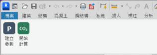
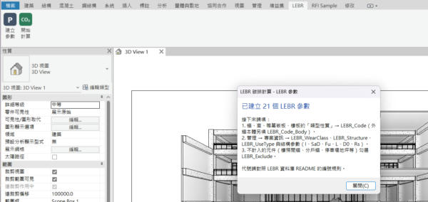
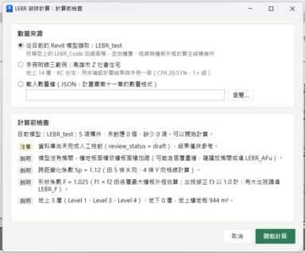
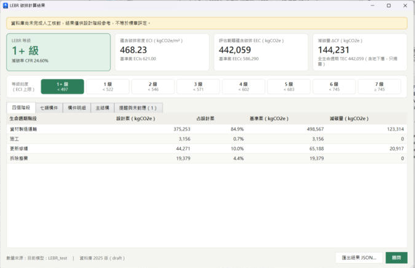

# LEBR 碳排外掛｜快速開始

這是一個 Revit 外掛。模型畫好後按一個按鈕，就會依照內政部建研所《2025 低碳建築評估手冊》，算出這棟建築的**碳排放量**和**低碳等級**（1+ 級最好，7 級最差）。

**你需要**：一台 Windows 電腦，裝有 Revit 2024、2025、2026 或 2027。**不用會寫程式。**

整個流程只有五步：

1. 安裝外掛
2. 建立參數
3. 填資料
4. 按「開始計算」
5. 匯出結果

---

## 第 1 步：安裝外掛（只要做一次）

1. **先關掉 Revit**。
2. 在這個資料夾裡，**雙擊「安裝外掛.bat」**。
3. 黑色視窗出現「安裝完成」後，按任意鍵關掉。
4. 打開 Revit。如果跳出「無法驗證此增益集的發佈者」，選 **「永遠載入」**。
5. 上方功能區會多一個 **LEBR** 頁籤，裡面有兩個按鈕：

> 不想用了，就雙擊「解除安裝外掛.bat」。

---

## 第 2 步：建立參數（每個專案做一次）

打開你的專案，按 **LEBR →「建立參數」**。看到「已建立 21 個 LEBR 參數」就完成了。

這一步會在你的元件上加幾個新欄位（都是 `LEBR_` 開頭），第 3 步要填這些欄位。

---

## 第 3 步：填資料

外掛不知道你畫的牆是「磚牆」還是「輕隔間」，所以要告訴它。**同一種類型只要填一次**，模型裡所有用這個類型的牆都會一起算。

### 3-1 填構件代號

1. 選一面牆（或窗、樓板、帷幕牆的玻璃嵌板）。
2. 在左邊「性質」面板按 **「編輯類型」**。
3. 往下找到 **`LEBR_Code`**，填入代號（看下表）。
4. 按「確定」。換下一種類型，重複以上步驟。

**外牆要多填一格**：外牆表面的材料填 `LEBR_Code`，牆本身的結構填 `LEBR_Code_Body`。例如一般 RC 外牆刷油漆，表面填 `OW-03`，本體填 `CW-00`。

**常用代號**（標「基準」的是手冊的一般做法；選其他做法，就會算出減碳量）：

| 我畫的是 | 填這個代號 |
|---|---|
| RC 外牆，表面貼磁磚 | `OW-01`（基準） |
| RC 外牆，表面刷塗料 | `OW-03` |
| 外牆本體：一般 RC 牆 | `CW-00`（填在 `LEBR_Code_Body`） |
| 磚牆隔間（雙面粉刷） | `IW-01`（基準） |
| 輕隔間牆（矽酸鈣板） | `IW-03` |
| 一般鋁窗，6mm 玻璃 | `W-G01-AL`（基準） |
| 帷幕牆玻璃，6+6mm Low-E | `CWW-G14-ALPVC` |
| 地板貼磁磚 | `F-G01`（基準） |
| 地板整體粉光 | `F-G02` |

找不到合適的代號時，問負責資料庫的組員，或打開 `lebr-db/draft/LEBR資料庫_核對用.xlsx` 查完整清單。

### 3-2 不要算進去的東西

樓梯間的牆、電梯間的牆、住宅的分戶牆、教室之間的隔間牆、停車場地板、屋頂板，這些依手冊規定不算。選中元件後，在「性質」面板**勾選 `LEBR_Exclude`**。

### 3-3 填專案資訊

上方選單 **管理 → 專案資訊**，往下找到 `LEBR_` 開頭的欄位：

| 欄位 | 填什麼 |
|---|---|
| `LEBR_WearClass` | 建築用途：住宅、自用辦公填 `L`；學校、出租辦公填 `M`；商場、旅館、醫院填 `H` |
| `LEBR_Structure` | 構造：通常填 `RC` |
| `LEBR_UseType` | 住宅、旅館、醫院填 `residential`；工廠填 `factory`；其他填 `other` |
| `LEBR_I`、`LEBR_SaD`、`LEBR_Fu`、`LEBR_L`、`LEBR_D0`、`LEBR_Rs` | 結構相關數字，向結構組或老師索取。**沒填的話，主結構不會被計算** |

> 只是練習、手邊沒有結構數字時，可以先填示範值：I = 1.25、SaD = 0.6、Fu = 3.0、L = 250、D0 = 300、Rs = 1.0。**算出來的結果不能當真。**

---

## 第 4 步：按「開始計算」

1. 按 **LEBR →「開始計算」**。
2. 先跳出 **「計算前檢查」**，告訴你還缺什麼：
    - **未對應**：還沒填代號的元件，這些會少算。
    - **缺少**：還沒填的專案資訊。
    - **說明**：外掛自己算出的樓層數、樓地板面積，請看看合不合理。

    

3. 想先補資料就按「取消」；要直接算就按 **「開始計算」**。
4. 出現**結果視窗**。左上角就是等級：

- **改了模型，要再按一次「開始計算」**，外掛不會自動重算。
- 下方「構件明細」分頁裡，雙擊任一列，Revit 會自動選取那些元件。

---

## 第 5 步：匯出結果

在結果視窗按 **「匯出結果 JSON…」**，存成檔案，交給做網頁的組員。

---

## 看不懂的詞

| 詞 | 白話意思 |
|---|---|
| 蘊含碳排 | 蓋這棟房子用的材料，從生產、運輸、施工、60 年內翻修到最後拆除，總共排放多少碳 |
| kgCO2e | 碳排放的單位：公斤二氧化碳當量 |
| 設計案／基準案 | 你的設計／同一棟房子改用手冊規定的一般做法。兩者相比就知道你減了多少 |
| 減碳率 CFR | 比一般做法少排了百分之幾。超過 20% 就是 1+ 級 |
| ECI | 每平方公尺樓地板的碳排，數字越小越好 |
| 等級 | 1+、1、2、3、4、5、6、7 共八級，1+ 最好。跟一般做法差不多是 5 級 |

---

## 常見問題

| 狀況 | 怎麼辦 |
|---|---|
| 沒看到 LEBR 頁籤 | 確認安裝時 Revit 已經關掉；重新雙擊「安裝外掛.bat」，再重開 Revit |
| 按鈕是灰色的 | 要先打開一個專案（不能是族群檔） |
| 每次開 Revit 都跳安全提示 | 選「永遠載入」，以後就不會再問 |
| 「未對應」有很多元件 | 那些類型還沒填 `LEBR_Code`，回第 3 步 |
| 顯示「主結構未計算」 | 專案資訊的結構數字沒填齊，回第 3-3 步 |
| 樓層數或面積不對 | 在專案資訊填 `LEBR_S`（樓層數）或 `LEBR_AFu`（地上樓地板面積）手動覆寫 |
| 結果上方有黃色提醒 | 資料庫還在核對中，結果只能當參考，不是正式的標章評定 |
| 安裝時說找不到「已編譯外掛」 | 你拿到的是 GitHub 版本，裡面沒有編譯好的檔案。請向組員索取交接包壓縮檔 |
| 用 Revit 2024 出現錯誤 | 2024 版還沒實際測過，請截圖給負責外掛的組員 |

---

想知道更多：要維護資料庫、修改程式或做網頁，看 **`組員操作指南.md`**；要接手整個專案，看 **`交接說明.md`**。
